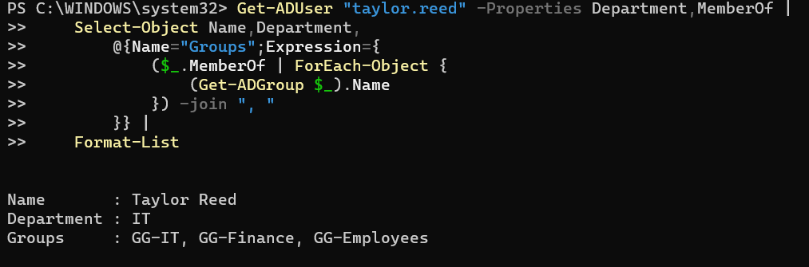
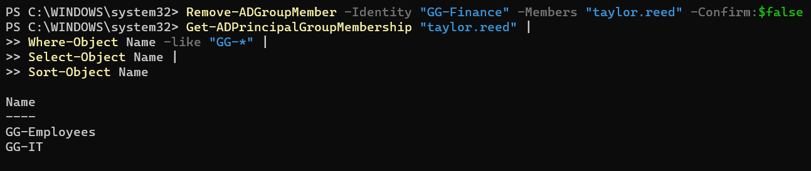

# IAM-001 — Excessive Access Following Department Transfer

**Project:** LAB-03 — Enterprise IAM & Security Operations  
**Finding ID:** IAM-001  
**Category:** Identity and Access Management (IAM)  
**Environment:** Windows Server 2025 / Active Directory  
**Assessment Type:** Controlled Lab Simulation  
**Risk Rating:** Medium (Scenario-Based)  
**Status:** Remediated — Directory-Level Verification Complete

---

## 1. Executive Summary

A simulated identity lifecycle assessment identified an excessive security-group membership following an employee department transfer.

Taylor Reed transitioned from Finance to IT and received the required IT group membership. However, the employee's previous Finance membership remained active, creating a potential least-privilege violation.

Using PowerShell, I identified the unnecessary membership, assessed its security implications, removed the obsolete assignment, and independently verified the corrected configuration.

**Outcome:** The identified directory-level access misconfiguration was successfully remediated.

## 2. Environment and Scope

The assessment was performed in an isolated Microsoft Hyper-V environment.

| Component | Configuration |
|---|---|
| Domain Controller | WL-DC01 |
| Operating System | Windows Server 2025 Standard Evaluation |
| Active Directory Domain | corp.whitleylab.test |
| Test Identity | taylor.reed |
| Current Department | IT |
| Administrative Tools | PowerShell, Active Directory Users and Computers |
| Relevant Security Groups | GG-Employees, GG-Finance, GG-IT |

**Scope:** Active Directory group membership assessment and remediation.

All identities were fictional. No production systems or protected business resources were involved.

## 3. Expected Access Configuration

Following the department transfer, the employee's memberships should reflect the current IT role.

| Security Group | Expected Membership | Justification |
|---|---|---|
| GG-Employees | Required | Baseline employee access |
| GG-IT | Required | Current department |
| GG-Finance | Not authorized | Previous department |

**Control objective:** Remove obsolete department membership while preserving required access.

## 4. Detection and Evidence

A PowerShell query was used to evaluate the employee's department and current Active Directory group memberships.

### Detection Command

```powershell
Get-ADUser "taylor.reed" -Properties Department,MemberOf |
    Select-Object Name,Department,
        @{Name="Groups";Expression={
            ($_.MemberOf | ForEach-Object {
                (Get-ADGroup $_).Name
            }) -join ", "
        }} |
    Format-List
```

### Observed Result

```text
Name       : Taylor Reed
Department : IT
Groups     : GG-IT, GG-Finance, GG-Employees
```

**Finding:** The employee retained GG-Finance membership despite transitioning to IT.

The observed configuration did not align with the simulated role-based access requirements.

## 5. Risk and Root-Cause Assessment

### Security Risk

Obsolete security-group memberships can create unnecessary authorization paths, particularly when groups provide access to sensitive applications or data.

Potential implications include:

- Excessive privileges inconsistent with current job responsibilities
- Unauthorized access opportunities if obsolete groups grant resource permissions
- Increased exposure from privilege accumulation
- Incomplete Joiner–Mover–Leaver (JML) access governance
- Reduced effectiveness of access certification and audit controls

### Root-Cause Assessment

The controlled simulation intentionally granted new IT membership without removing obsolete Finance membership.

This represents an **incomplete mover workflow**, where access provisioning occurs without corresponding access reconciliation and deprovisioning.

The cause was established by the design of the simulation, rather than an independent production root-cause investigation.

### Risk Rating

**Medium — Scenario-Based**

The preliminary rating reflects the potential consequences of excessive departmental membership.

Actual unauthorized access was not demonstrated. The lab did not associate GG-Finance with a protected resource, so the observed issue was limited to directory-level access configuration.

A production rating would depend on the resources accessible through the group, their sensitivity, and the relevant threat exposure.

## 6. Remediation

The obsolete Finance group membership was removed using PowerShell.

### Remediation Command

```powershell
Remove-ADGroupMember -Identity "GG-Finance" -Members "taylor.reed" -Confirm:$false
```

The command specifically removed the employee from GG-Finance. It did not request changes to the account's enabled state or other group memberships.

## 7. Post-Remediation Verification

A separate PowerShell query was used to validate the corrected membership configuration.

### Verification Command

```powershell
Get-ADPrincipalGroupMembership "taylor.reed" |
    Where-Object Name -like "GG-*" |
    Select-Object Name |
    Sort-Object Name
```

### Verified Output

```text
Name
------------
GG-Employees
GG-IT
```

### Verification Criteria

| Requirement | Verification Result |
|---|---|
| Retain GG-Employees membership | Passed |
| Retain GG-IT membership | Passed |
| Remove GG-Finance membership | Passed |
| Independently verify account-enabled state | Not tested |
| Test authorization against a protected Finance resource | Not tested |

**Remediation Result:** All three directory-level membership criteria passed.

The verification confirmed that the obsolete Finance membership was absent while required IT and employee memberships remained intact.

Protected-resource authorization and independent account-status verification were outside the completed validation scope.

## 8. Recommended Preventive Controls

For an enterprise environment, the following measures would reduce similar access risks:

1. **Formalize JML workflows:** Define standardized provisioning, department-transfer, and offboarding procedures.
2. **Reconcile existing access:** Compare current memberships with approved role requirements during transfers.
3. **Require authorization:** Establish approval workflows for department-specific and privileged access.
4. **Perform periodic access reviews:** Validate permissions against current job responsibilities.
5. **Automate membership updates:** Use identity governance tooling and PowerShell automation where appropriate.
6. **Monitor access changes:** Audit security-sensitive group modifications and review unexpected changes.
7. **Preserve evidence:** Maintain access approvals, remediation records, and post-change verification.

These controls support least privilege, accountability, and audit readiness.

## 9. Final Assessment

**Finding Status: Remediated — Directory-Level Verification Complete**

The simulated access misconfiguration was identified, assessed, corrected, and verified using Active Directory and PowerShell.

### Technical Capabilities Demonstrated

- Active Directory identity administration
- Role-based group membership assessment
- Joiner–Mover–Leaver lifecycle analysis
- Least-privilege control validation
- Targeted PowerShell remediation
- Independent post-remediation verification
- Risk assessment and security documentation

The exercise demonstrates how security analysts can identify incomplete access transitions and validate corrective actions using reproducible administrative evidence.

## 10. Supporting Evidence

The following artifacts document the identification,
remediation, and verification of IAM-001.

| Evidence | Description | Status |
|---|---|---|
| Initial membership review | Baseline group assignments | Captured |
| Department transfer | Obsolete Finance membership retained | Verified |
| Detection evidence | Excessive membership identified | Verified |
| Remediation | GG-Finance membership removed | Executed |
| Post-remediation verification | Correct memberships confirmed | Verified |

### Evidence A — Before Remediation



**Observation:** Taylor Reed's department was IT, but
GG-Finance membership remained assigned.

**Security finding:** Potential excessive authorization
caused by an incomplete department-transfer workflow.

### Evidence B — After Remediation



**Remediation:** Removed obsolete GG-Finance membership.

**Verification:** GG-Employees and GG-IT remained assigned;
GG-Finance was absent.

### Evidence Assessment

The screenshots demonstrate directory-level remediation.
Resource-level authorization testing was not performed.

**Evidence handling:** Fictional lab identities only.
---

## Conclusion

This investigation demonstrates a structured security assessment workflow:

**Detect → Analyze → Assess Risk → Remediate → Verify → Document**

The completed lab provides hands-on evidence of IAM administration, least-privilege assessment, PowerShell auditing, and security control verification.

**Disclaimer:** All activity was performed in an isolated, authorized cybersecurity training environment using fictional identities. No production systems or real employee data were involved.
