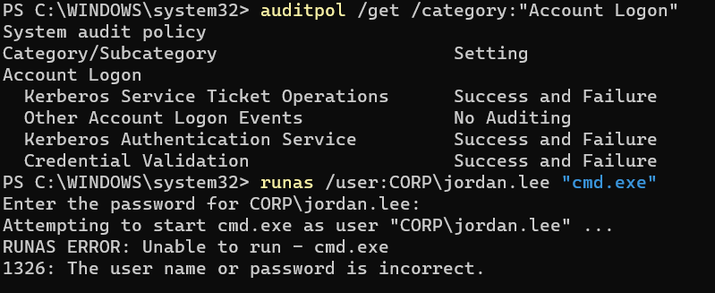
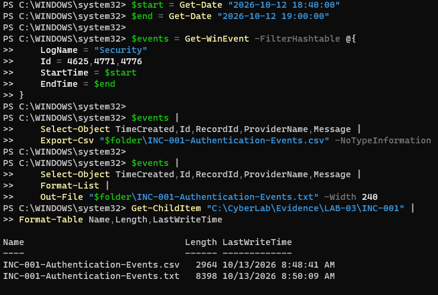
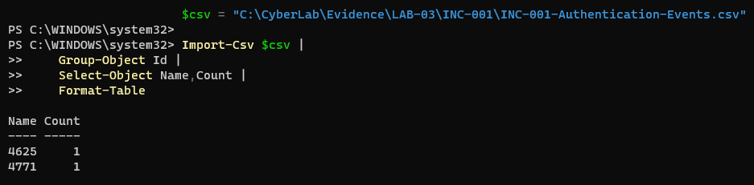

# INC-001 — Failed Authentication Investigation

**Project:** LAB-03 — Enterprise IAM & Security Operations  
**Incident ID:** INC-001  
**Category:** Security Operations / Authentication Monitoring  
**Environment:** Windows Server 2025 / Active Directory  
**Assessment Type:** Authorized Lab Simulation  
**Status:** Investigation Complete — Event Evidence Validated

---

## 1. Executive Summary

A controlled failed-authentication attempt was generated against a fictional Active Directory account to validate Windows Security auditing and practice security event investigation.

Using PowerShell, I identified and analyzed Windows Security Event IDs **4625** and **4771**, interpreted authentication failure codes, examined the originating system, and exported the associated security records.

The collected evidence was consistent with the intentionally generated incorrect-password attempt.

**Outcome:** Successfully detected, investigated, correlated, and documented a simulated authentication failure using native Windows security telemetry.

## 2. Environment and Scope

| Component | Configuration |
|---|---|
| Domain Controller | WL-DC01 |
| Operating System | Windows Server 2025 Standard Evaluation |
| Active Directory Domain | corp.whitleylab.test |
| Test Account | CORP\jordan.lee |
| Authentication Tool | Windows `runas` |
| Investigation Tool | PowerShell `Get-WinEvent` |
| Evidence Source | Windows Security Event Log |

**Scope:** Authentication failure monitoring, event interpretation, correlation, and evidence export.

All activities were conducted within an isolated, authorized cybersecurity lab using fictional identities.

## 3. Investigation Objectives

The investigation aimed to establish:

1. Whether Windows recorded the failed authentication.
2. Which security event IDs were generated.
3. Which identity was targeted.
4. Where the authentication request originated.
5. What the recorded failure codes indicated.
6. Whether the exported dataset matched the identified events.

## 4. Audit Policy Configuration

Before generating the authentication failure, the Windows account-logon audit policy was inspected.

### Audit Verification Command

```powershell
auditpol /get /category:"Account Logon"
```

Success and Failure auditing were enabled for:

- Kerberos Authentication Service
- Kerberos Service Ticket Operations
- Credential Validation

A subsequent audit policy query confirmed that all three selected subcategories reported **Success and Failure**.

**Control objective:** Ensure authentication failures are recorded and available for security investigation.

## 5. Controlled Authentication Test

A Windows `runas` command was executed on the domain controller using a fictional employee account.

### Test Command

```powershell
runas /user:CORP\jordan.lee "cmd.exe"
```

An intentionally incorrect password was entered.

### Observed Result

```text
RUNAS ERROR: Unable to run - cmd.exe
1326: The user name or password is incorrect.
```

Windows rejected the credentials, confirming that the requested authentication was unsuccessful.

This activity was authorized and performed exclusively for laboratory testing.

## 6. Security Event Collection

The Windows Security Event Log was queried for authentication-related events within the test period.

### Investigation Command

```powershell
$start = Get-Date "2026-10-12 18:40:00"
$end = Get-Date "2026-10-12 19:00:00"

Get-WinEvent -FilterHashtable @{
    LogName = "Security"
    Id = 4625,4771,4776
    StartTime = $start
    EndTime = $end
} | Select-Object TimeCreated,Id,ProviderName,Message |
    Format-List
```

### Verified Findings

| Evidence Field | Observed Value |
|---|---|
| Event Timestamp | October 12, 2026, 18:45:05 |
| Target Account | CORP\jordan.lee |
| Event ID 4625 | Failed Windows logon |
| Event ID 4771 | Kerberos pre-authentication failure |
| Logon Type | 2 — Interactive |
| Authentication Package | Negotiate |
| NTSTATUS | 0xC000006D |
| Substatus | 0xC000006A |
| Kerberos Failure Code | 0x18 |
| Source Workstation | WL-DC01 |
| Source Address | ::1 |

The event records were identified within the defined investigation window.

## 7. Technical Analysis

### Event 4625 — Failed Windows Logon

Event ID 4625 recorded an unsuccessful logon request for `jordan.lee`.

The event included:

- **0xC000006D:** Authentication failure
- **0xC000006A:** Incorrect password
- **Logon Type 2:** Interactive authentication

These values were consistent with the failed Windows `runas` attempt.

### Event 4771 — Kerberos Pre-Authentication Failure

Event ID 4771 recorded a Kerberos pre-authentication failure involving the same account.

The event reported:

- **Failure code 0x18:** Invalid pre-authentication information, consistent with an incorrect password
- **Service:** `krbtgt/CORP`
- **Pre-Authentication Type:** 2

This event provided additional authentication telemetry from the Kerberos service.

### Source Identification

Both event records reported the IPv6 loopback address:

```text
::1
```

The IPv6 loopback address indicates that the authentication activity originated from the local system, consistent with the controlled test performed on WL-DC01.

The associated workstation was `WL-DC01`, consistent with the location where the controlled test was conducted.

No external source address was identified in the collected records.

### Event Correlation

Events 4625 and 4771 shared:

- The same target account
- The same recorded timestamp
- Compatible authentication failure codes
- The same local source context

**Analyst assessment:** The matching account, timestamp, local source, and compatible failure codes strongly correlate Events 4625 and 4771 with the controlled authentication scenario.

These records provide complementary evidence of unsuccessful authentication. They do not independently establish multiple distinct login attempts, nor was a shared transaction identifier used to prove that both events originated from the same authentication transaction.

## 8. Evidence Preservation and Validation

The relevant Security events were exported to CSV and TXT formats using PowerShell.

### Exported Evidence

| File | Purpose |
|---|---|
| INC-001-Authentication-Events.csv | Structured event records |
| INC-001-Authentication-Events.txt | Human-readable event records |

The original exports were retained within the private laboratory environment.

### Export Validation

The CSV export was reviewed using PowerShell:

```powershell
Import-Csv "INC-001-Authentication-Events.csv" |
    Group-Object Id |
    Select-Object Name,Count
```

### Verified Results

| Event ID | Count |
|---|---:|
| 4625 | 1 |
| 4771 | 1 |
| **Total** | **2** |

The validation confirmed that the exported dataset contained exactly one Event 4625 and one Event 4771.

### Evidence Integrity Limitation

Event-count validation confirmed the number and types of exported records. It did not establish cryptographic file integrity or prove that the files had remained unchanged after collection.

SHA-256 hashing and a formal chain-of-custody record were not performed during the original evidence collection.

For a production investigation, cryptographic hashes, secure evidence storage, access controls, and documented handling procedures would improve evidence integrity and traceability.

Raw exports remain private. Only reviewed and sanitized artifacts will be published.

## 9. Security Analyst Assessment

**Classification:** Authorized simulated authentication failure.

The evidence supported an incorrect-password authentication attempt originating locally on WL-DC01.

Because the activity was deliberately generated, it did not constitute a confirmed malicious security incident.

In a production environment, additional investigation would be necessary to distinguish routine authentication errors from potentially suspicious activity.

### Additional Investigative Considerations

- Frequency and timing of failed authentication attempts
- Number of affected user accounts
- Source systems and network addresses
- Account lockout events
- Successful logons following failed attempts
- Privileged account involvement
- Related endpoint and SIEM alerts
- Indicators of password spraying or brute-force activity

**Assessment:** One isolated failed authentication, without additional suspicious context, is insufficient to establish malicious activity.

## 10. Recommended Detection and Response Controls

The following controls would strengthen authentication monitoring in an enterprise environment:

1. **Maintain authentication auditing:** Enable and verify appropriate Success and Failure audit policies.
2. **Centralize security telemetry:** Forward relevant authentication events to a SIEM.
3. **Establish detection rules:** Alert on unusual authentication frequency, repeated failures, or multiple targeted accounts.
4. **Correlate security events:** Analyze authentication activity across systems, identities, and protocols.
5. **Monitor privileged accounts:** Apply heightened monitoring to administrative and sensitive identities.
6. **Preserve investigative evidence:** Use secure storage, timestamps, cryptographic hashing, and documented evidence handling.
7. **Define escalation procedures:** Investigate and escalate suspicious activity according to organizational incident response requirements.

These measures are production recommendations, not claims of additional controls implemented in this lab.

## 11. Final Assessment

**Investigation Status: Complete — Event Evidence Validated**

The controlled test successfully generated Windows authentication failure telemetry that was retrieved, analyzed, correlated, exported, and validated.

### Technical Capabilities Demonstrated

- Windows Security auditing configuration
- Failed-authentication investigation
- Kerberos pre-authentication analysis
- Windows Event ID 4625 and 4771 interpretation
- PowerShell-based log retrieval
- Source identification and event correlation
- Security evidence export and record-count validation
- Incident documentation and response recommendations

**Investigation workflow:**

Generate Test Activity → Collect Logs → Analyze → Correlate → Validate → Document

## 12. Supporting Evidence

The following artifacts support the controlled
authentication investigation.

| Evidence | Description | Status |
|---|---|---|
| Audit policy | Authentication auditing | Verified |
| Failed authentication | Windows runas error 1326 | Captured |
| Event 4625 | Failed interactive logon | Verified |
| Event 4771 | Kerberos pre-authentication failure | Verified |
| CSV/TXT exports | Security event records | Created |
| Export validation | Two records accounted for | Verified |
| SHA-256 integrity check | Not performed | Not performed |
| Public screenshots | Three supporting screenshots | Published |

### Evidence A — Authentication Failure



**Observation:** A controlled incorrect-password attempt
returned Windows error 1326.

### Evidence B — Security Event Collection



**Observation:** PowerShell commands collected and exported
the relevant Security events.

**Limitation:** The screenshot does not display the
full contents of the individual events.

### Evidence C — Export Validation



**Verification:** The CSV contained one Event 4625
and one Event 4771.

### Evidence Handling and Limitations

Original event exports remain private. Cryptographic
integrity hashing was not performed during collection.

This was a controlled lab test, not a malicious incident.
---

## Conclusion

This investigation demonstrates an evidence-based security operations workflow using Windows Server, Active Directory, and PowerShell.

The exercise reinforces the importance of authentication monitoring, technical event interpretation, responsible event correlation, and accurate reporting of investigative findings and limitations.

**Disclaimer:** This was an authorized cybersecurity training exercise conducted in an isolated environment using fictional identities. No production systems or real employee accounts were involved.
